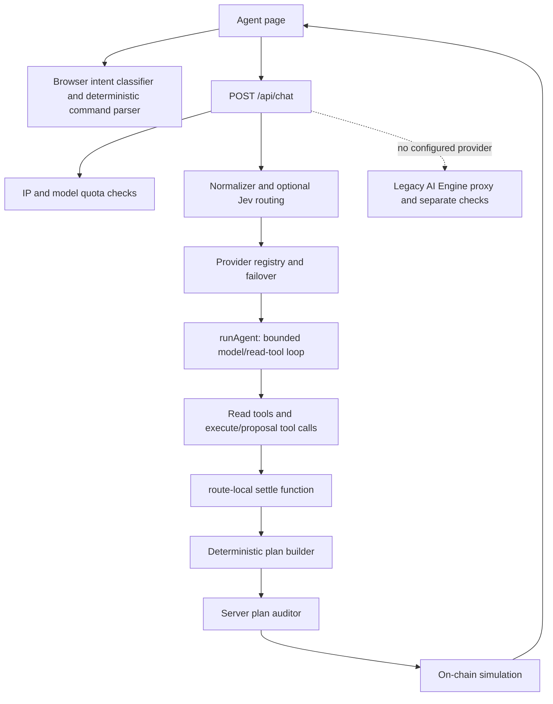
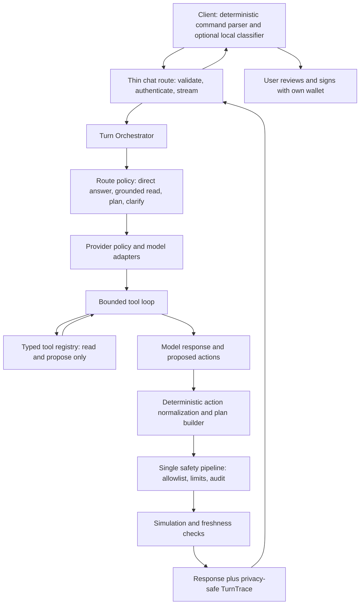

# Luca agent harness: current state and target architecture

**Status:** architecture proposal, based on the current source tree. This is not an implementation or a claim of production verification.

## Recommendation

Keep Luca's domain-specific transaction pipeline. Improve the harness around it so one server-side turn coordinator owns routing, model calls, tool execution, proposal construction, policy checks, simulation, and the final trace. Do not delegate transaction construction, token resolution, route selection, calldata, or signing authority to a language model.

The present implementation already has strong safety mechanisms, but its orchestration is spread across the HTTP route, provider registry, agent loop, normalizer, Jev classifier, and a legacy AI Engine path. The main architectural job is to make those seams explicit and ensure every model path reaches the same plan and safety pipeline.

## Current implementation map



### What is already strong

- Provider adapters translate model-specific tool formats into common chat results in `src/lib/ai/providers/` and `src/lib/ai/types.ts`.
- `runAgent` bounds tool rounds, deduplicates reads, and executes reads server-side.
- The model's action proposal is converted by deterministic code and audited before the plan is returned. The app still asks the user's wallet to sign each transaction.
- Browser-local inference is deliberately limited to intent/context classification.
- The chat route bounds client-supplied history and grounding and applies server-side rate/quota controls.

### Structural issues to resolve

1. **The HTTP route owns too much policy.** `src/app/api/chat/route.ts` is about 1,089 lines and currently owns request parsing, rate/quota checks, provider dispatch, normalization, Jev, orchestration, plan construction, audit, simulation, stream framing, recovery, and the legacy proxy. Its local `settle` and `recover` closures make route behavior hard to exercise independently.
2. **There are two model execution paths.** The provider path uses the common builder, auditor, and simulator. When no provider is configured, the route forwards to `AI_ENGINE_API_URL` and applies a separate amount/target check. Both paths need the same downstream policy, or the legacy path should be removed after migration.
3. **Provider policy is implicit and inconsistent.** `getProvider` selects a primary, while `getProviderChain` assembles fallback providers in a separate order. The source comments say Ollama is the first implicit provider, but the code returns AgentRouter first if its key exists. A configured `AI_PROVIDER` avoids that particular ambiguity; unset configuration does not.
4. **Routing layers overlap.** Browser intent classification, deterministic command parsing, the normalizer model, Jev classification, and the full tool-using model all influence the turn. Their roles need one documented routing policy, so a classifier can suggest a path but cannot bypass transaction policy.
5. **The model result and operational trace are too small for a first-class harness.** `ChatResult` carries text, tool-derived actions/reads, provider, and model. A durable turn record should also identify the route, provider attempts, tool timings/outcomes, policy result, simulation result, and terminal stage, without persisting prompts, tool arguments, or transaction payloads.
6. **Quota identity is not authenticated.** The route currently meters a wallet address supplied in the request body; its own comment calls out signed wallet/session binding as the stronger follow-up. Treat this as an operational abuse limitation, separate from transaction safety.

## Target architecture



### One turn contract

The route should call one module with a compact interface, conceptually:

```ts
runTurn(input, dependencies): Promise<TurnResult>
```

`input` contains validated user text/history, wallet-authenticated identity, active chain, bounded product preferences, and a request ID. `dependencies` are supplied at the seam: provider policy, tool executor, deterministic plan builder, auditor, simulator, quota store, and trace sink. The orchestrator owns sequencing and bounded retries; adapters own vendor wire formats; the route owns HTTP and streaming only.

`TurnResult` should be a discriminated outcome rather than a bag of optional fields:

- `answer`: grounded prose/cards, no proposed action.
- `clarification`: the required missing user input.
- `plan`: canonical plan plus audit/simulation status, ready for user review.
- `refusal`: policy rejection with a stable reason code.
- `unavailable`: provider/tool/dependency failure with a retryable classification.

The model's tool call that proposes an action must be named and typed as a **proposal**, not execution. It never invokes a wallet, sends a transaction, or mutates chain state. Only the existing user-signing client can do that.

### Provider and fallback policy

- Make the configured default explicit: `AI_PROVIDER=ollama` means Ollama is primary. If configuration is absent, use one documented precedence table and have both the provider picker and health/config endpoint derive from the same function.
- A user-selected model is pinned for that request. Do not silently switch the selected model to a different provider unless the UI and response explicitly disclose that fallback policy.
- For the default model, fallback only on classified transient provider failures (network, timeout, 5xx, temporary rate limit). Do not fallback on policy/content refusal, malformed tool calls, quota exhaustion, or deterministic builder/auditor rejection.
- Record provider/model for every attempt and the final answer. Keep provider capability metadata (streaming, tool calls, structured output, context limits) next to each adapter instead of assuming all models behave identically.
- Migrate the legacy AI Engine behind the same `ChatProvider`/model-turn interface, then pass its result through the same tool validation, builder, auditor, simulator, and result contract. Remove the separate target/amount guard once parity is proven; it is not an equivalent substitute for the shared policy pipeline.

### Tool policy

- A server-owned registry defines each tool's name, schema, mode (`read` or `propose`), supported chains, required context, timeout, and output limits.
- The orchestrator validates every model tool request against that registry before execution. Unknown tools and invalid arguments fail closed and become trace events.
- Read tools may run in parallel only when independent, read-only, and within per-turn concurrency limits. Mutating actions remain proposals that feed the deterministic builder.
- Tool results are untrusted context. They may ground a response, but they cannot add an address to the allowed contract registry or weaken an audit rule.
- Keep the deterministic parser as the fast path for supported direct commands. Local/browser classification and Jev can guide routing but never supply transaction fields or suppress required checks.

### Safety pipeline

Every proposed transaction from every provider or legacy adapter must follow the same order:

1. Validate proposal schema and user-stated intent.
2. Resolve assets, chain, contract addresses, route, and numeric fields from canonical registries and trusted chain reads.
3. Build the canonical plan deterministically.
4. Apply one server-side policy/audit implementation with fail-closed behavior and tightening-only user limits.
5. Simulate the exact canonical plan; mark unknown simulation as unverified, never as passed.
6. Return only a reviewable plan. The wallet signature and on-chain contract checks remain the execution gates.

No provider fallback or response-format branch may skip these steps.

### Turn trace and operational harness

Emit one privacy-safe trace per turn with:

- `turnId`, timestamp, route decision, chain, and a pseudonymous wallet/session key;
- provider attempts with model, latency, retry/fallback reason, and terminal status;
- tool names, round, latency, and outcome class, but not raw arguments or returned balances;
- plan present/absent, audit result/reason codes, and simulation result/reason code;
- total latency, quota outcome, and final outcome kind.

Do not log raw prompts, conversation history, wallet balances, full tool arguments, calldata, signatures, or secrets. Add a repeatable evaluation harness around the same `runTurn` seam: fixed cases for grounded reads, missing-field clarification, valid and invalid proposals, malicious/unknown tools, provider timeouts, fallback disclosure, and legacy-path parity. Use deterministic fakes for providers, tools, chain reads, auditor, and simulator; separately run a small live-provider smoke check.

## Migration sequence

1. **Freeze behavior and contracts.** Document route outcomes, current providers, tool modes, and where each current plan path reaches audit/simulation. Add characterization coverage at the proposed `runTurn` seam before moving code.
2. **Extract without changing behavior.** Move provider selection, normalizer/Jev routing, tool loop, settle/build/audit/simulate, and trace creation behind `runTurn`. Keep `/api/chat` as validation, auth/quota, stream adaptation, and HTTP mapping.
3. **Unify execution paths.** Adapt the legacy engine to the neutral result contract and force it through the shared pipeline. Compare output and policy behavior, then remove the parallel fallback checks.
4. **Make policy explicit.** Centralize provider precedence/failover, distinguish transient from terminal errors, disclose fallback in response metadata, and bind quota to verified wallet/session identity.
5. **Add harness quality gates.** Run deterministic scenario evaluations and provider contract checks for Ollama and each enabled adapter. Track p50/p95 first-token and full-turn latency, tool-round counts, fallback rate, policy rejection rate, and simulation coverage.

## Completion criteria

- There is one `runTurn` entry point and one canonical result contract.
- Every model provider, including the legacy engine during migration, reaches the exact same deterministic builder, policy auditor, and simulator.
- Provider precedence and fallback behavior are computed from one policy module and visible in the result/trace.
- A plan cannot be returned as ready when audit failed or simulation failed; an unavailable simulation is clearly marked.
- The route contains no business orchestration beyond mapping HTTP input/output and streaming lifecycle events.
- Scenario evaluations cover read, clarify, plan, refusal, fallback, timeout, and hostile-tool cases.
- Traces are sufficient to explain slow/failing turns without retaining sensitive user prompts or transaction data.

## Scope note

This document is a design proposal based on repository inspection. No Luca code was changed as part of producing it, and no behavior, deployment, or live-provider acceptance is claimed here.
