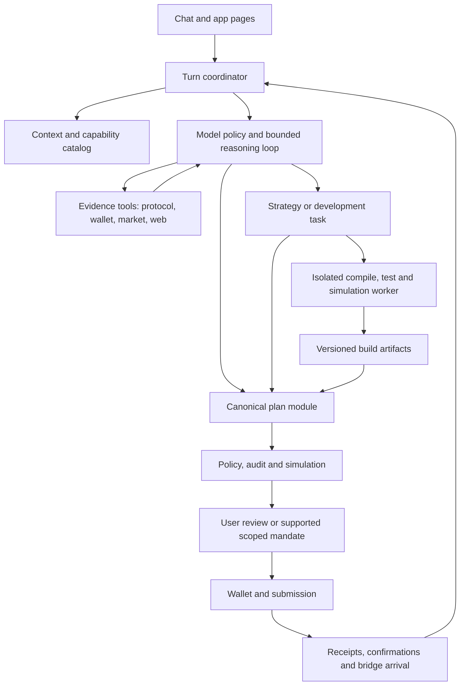

# Luca: full agent vision and integration implementation plan

Status: proposed delivery specification, 9 November 2026. Repository inspection informs the baseline below; this document does not establish production readiness. Existing uncommitted changes remain separate from this planning work.

This is the umbrella plan for [protocol coverage](./LUCA_PROTOCOL_INTEGRATION_PLAN.md), the [agent harness](./LUCA_AGENT_HARNESS.md), and the [multichain interface](./MULTICHAIN_INTERFACE_MAP.md). Those documents supply existing implementation detail. Where an older snapshot disagrees with current source, recheck the source and record evidence before implementation.

## 1. Product outcome

Luca becomes Kaleido's conversational operating interface for DeFi: understand the user, inspect current protocol and wallet state, research opportunities, explain tradeoffs, develop strategies, prepare transactions, follow execution, and help build and deploy reviewed contracts or launch tokens through supported launchpads.

Users should be able to ask ordinary questions without learning commands. Examples:

- “How many launchpads do you integrate on Arc?”
- “Show my BSC balance,” while their wallet is connected to Arc.
- “Compare the cost of swapping here with bridging first.”
- “Why is my position losing money even though it earned fees?”
- “Compare this external lending protocol with Kaleido using current data.”
- “Move $100 of my USDC to the best supported opportunity within these limits.”
- “Design a contract that rebalances this position; show tests and deployment costs.”
- “Prepare a token launch through Peach with these parameters.”

Each answer or task must preserve the user's chain, assets, intent, constraints, and actual permissions. A missing adapter may limit execution while still allowing sourced research. Research coverage, tool coverage, and transaction readiness are separate product facts.

## 2. Baseline and concrete gaps

| Area | Observed foundation | Work still required |
| --- | --- | --- |
| Chain context | `turnContext.ts` validates a chain and exclusive network mode. | Distinguish wallet, browse, explicitly requested, and action scopes throughout every tool and task. Authenticate identity separately from address validation. |
| Knowledge | `capabilities.ts`, product facts, FAQ, and docs grounding exist. Local launchpad changes add Argus/Peach answers. | Consolidate duplicated facts; distinguish configured adapters, runtime gates, operation support, and health. Stop stale conversation text from overriding current context. |
| Reasoning | Provider adapters, bounded tool loop, deduplicated reads, streaming and fallback exist. | One coordinator, typed outcomes, scoped memory, targeted tool availability, evidence handling, budgets and durable tasks. |
| Reads and actions | `toolCatalog.ts` and `readTools.ts` cover many Kaleido products; deterministic builders and auditor exist. | Verify coverage per chain and operation; share underlying readers with app pages; prevent failed reads becoming zero. |
| Routing | Native routes, KyberSwap, LI.FI and Fly.trade code exists. | Verify one comparison/build policy across UI and Luca, including native value, fees, spender, refreshed calldata and partial provider coverage. |
| Launchpads | Argus and Peach token discovery/trading paths exist. | Share integration inventory; verify address-to-card-to-plan behavior; implement creation adapters separately. Trading support does not establish token-creation support. |
| Research | No general online research interface was established in the inspected tool catalog. | Build sourced public research and validated external-protocol read adapters. |
| Contract development | No general compile/test/deploy workflow was established in the inspected catalog. | Build isolated development jobs, reviewed deployment artifacts, a dedicated deployment action type and receipt verification. |
| Operations | Existing deployment direction is Hostinger. | Durable workers, task recovery, release identity, operational alerts and same-commit GitHub/Hostinger verification. |

These are starting observations, not a full code audit. The first delivery produces an evidence-backed matrix before claiming that any product works across every network.

## 3. Architecture and module ownership

Use deep modules with small interfaces. Reuse the existing transaction core and replace overlapping orchestration incrementally.



| Module | Small interface | Owns |
| --- | --- | --- |
| Turn coordinator | `runTurn(input, dependencies)` | Scope, reasoning budget, tool dispatch, cancellation, typed result and progress events. HTTP route only adapts requests/streams. |
| Capability catalog | `resolveCapabilities(scope)` | Chains, product operations, integration identity, gates, health dependencies and readiness evidence. |
| Evidence tools | `read(request, context)` | Validated reads with timestamps, coverage, provenance and explicit failure states. Protocol, wallet, market and web adapters vary behind this seam. |
| Plan module | `prepare(proposal, context)` | Deterministic asset resolution, quote selection, amounts, targets, approvals, deadlines, audit and simulation. |
| Task runtime | `start(spec)` / `resume(taskId)` / `cancel(taskId)` | Persistent progress, dependencies, artifacts, checkpoints, budgets and recovery after worker restart. |
| Development worker | `buildAndCheck(spec)` | Isolated source files, pinned compilation, tests, static checks and fork simulation; returns artifacts, never a signature. |
| Execution tracking | `observe(executionId)` | Submission, receipts, replacements, confirmation depth, bridge arrival, outcome and reconciliation. |

New interfaces are introduced where actual adapters vary; avoid wrappers that only rename an existing function. Dependencies are injected at these seams so tests can exercise complete outcomes without real funds.

## 4. One authoritative integration catalog

Create a versioned catalog whose entries represent a product operation on a chain. Do not reduce an integration to one `enabled` flag.

Each entry carries:

- Integration ID, kind, chain ID and network mode; kinds include Kaleido deployment, swap aggregator, bridge provider, launchpad and external research/read integration.
- Operations such as inspect, quote, buy, sell, create token, add liquidity, borrow, cancel or deploy contract, each declared independently.
- Reviewed assets and contracts, ABI/code identities where relevant, provider mappings, runtime gates and required RPC/indexer/oracle/keeper dependencies.
- Configured state, observed health, observation time, evidence references and readiness per read, quote, build, audit, simulate and submit operation.
- Adapter version and documented limitations. Unknown readiness stays unknown; an upstream marketing claim cannot promote an operation to executable.

Argus and Peach are two launchpad entries on Arc. KyberSwap, LI.FI and Fly.trade are aggregator entries. A provider's support for many networks expands possible future coverage but cannot implicitly enable Kaleido execution on unregistered chains.

Generate model-facing capability facts, user-facing availability, tool eligibility and acceptance matrices from this catalog. Keep runtime health in a separate short-lived observation overlay; deployment configuration and recent health have different lifetimes.

The current local launchpad answer is a temporary correction. Replace its repeated names/counts with catalog queries. Its matcher must decline research, strategy, price, launch-creation and multi-intent questions. Add explicit-target tests: connected to Arc but asking about BSC must answer about BSC. Available launchpad trading must never set creation or all execution surfaces to available by implication.

Flash loans and other disputed features require an explicit contract/ABI and operational inventory. Neither absence from a prompt nor a previous assistant statement establishes availability or absence.

## 5. Context, memory and authority

Construct a fresh turn context on the server with request/session identity, authenticated wallet identity when needed, actual wallet network, active mode, browse scope, explicit requested chain(s), user constraints and catalog version. Wallet/provider state originates at the client and is validated; address-shaped input alone is not proof of wallet ownership.

Reads can target a named chain without switching the wallet. Actions retain the chain of their selected asset, position or market. Explicitly asking about another mode may produce a labelled informational answer; it never enables a transaction in that mode. Switching wallet, account or mode invalidates affected quotes, pending reviews and private caches.

Memory has four classes:

1. Conversation: bounded messages and summaries, with corrections and references.
2. Task state: structured objective, constraints, selected assets, pending choices, plan revision and receipts.
3. Preferences: user-approved defaults such as display currency, slippage ceiling or risk preference, scoped to identity.
4. Evidence cache: source observations with expiry; never treat a summary as a fresh balance, current chain or permission.

Store `(chainId,address)` for tokens and `(chainId,venue,positionId)` for positions. Never resolve holdings by symbol alone. Every plan is tied to an identity, context version and artifact/quote revision.

## 6. Understanding ordinary language and model orchestration

Use the deterministic parser for unambiguous direct commands and narrow catalog lookups. Its interpretation must preserve every condition and explicit chain. Questions, incomplete strategies, unsupported constraints, negations and compound requests continue to reasoning or clarification. A parse that discards part of the request is not a successful parse.

The optional on-device model supplies bounded intent/reference hints. It cannot set transaction amounts, substitute chains, claim live facts or determine execution eligibility. It must never delay a cloud turn waiting for a download.

The cloud model handles ordinary conversation, explanation, research and planning with eligible tools. It can answer stable concepts without a live call, query the catalog for protocol facts, and select live tools when an answer needs balances, markets or current state. Tool outputs include evidence; stale docs are lower authority than the catalog and verified observations. Do not add another expensive classifier call before every model turn.

Keep Ollama as the requested default, with the intended model configured centrally and confirmed through a provider smoke check. A single provider policy supplies defaults, health reporting, model selection and failover. Auto chooses by required tool support, task complexity, context size and measured latency; an explicit user model choice remains visible. Disclose any permitted provider fallback. A model cannot invent web access or contract execution when the tool is absent.

Use bounded read rounds, concurrency and per-turn spending. Cache stable catalog facts, batch independent reads, stream progress immediately, and retain useful partial results. Normalizer calls are optional only when measurements show a latency or cost benefit. Display short action summaries and evidence rather than private chain-of-thought.

## 7. Evidence and live analysis

All read adapters return a common envelope:

```ts
type EvidenceResult<T> = {
  status: "ok" | "partial" | "unavailable" | "unsupported";
  data: T | null;
  scope: { chainIds: number[]; networkMode: "mainnet" | "testnet" };
  source: string;
  observedAt: string | null;
  fetchedAt: string;
  blockNumber?: string;
  coverage: { requested: string[]; succeeded: string[]; failed: string[] };
  warnings: string[];
  evidenceId: string;
};
```

Successful measurements may be zero; unavailable measurements are null. Aggregation retains priced/unpriced assets and failed chains. Health factors are per lending account and chain, never summed. Define freshness budgets per data class: configuration, indexed historical metrics, market quotes and pending execution each have different requirements. Quote validity must be bounded by provider expiry and execution policy.

Add reusable analysis operations: portfolio exposure, lending health and capacity, LP range/fee/value changes, bridge costs, realized fees, supported-route comparison, and scenario analysis. Return assumptions and coverage alongside calculations. Projections are estimates and require documented inputs; no invented APY or guaranteed return.

Use the same readers as app pages. Rewards distinguish settled, available and pending points; leaderboard data uses precomputed/cached reads. Analytics reconciles verified native plus aggregator-routed Kaleido activity, with bridge and swap legs deduplicated. External venue-wide volume or pool fees never become Kaleido revenue.

## 8. Full product coverage contract

| Product | Required user outcomes | Completion evidence |
| --- | --- | --- |
| Wallet/portfolio | Balances on a named chain or all active-mode chains; priced holdings, debts, vaults and LP exposure. | Same scoped results as shared readers; RPC outage preserves other chains and reports missing coverage. |
| Swaps | Quotes and review for registered or eligible address-based assets; actual route, costs and minimum. | UI and Luca share quote/build policy; exact native value, decimals, spender and refreshed route pass audit and simulation. |
| Bridges | Compare supported corridors, review transfer, follow departure and arrival. | Source receipt and destination delivery tracked separately; provider timeout cannot resubmit a completed leg. |
| Lending/borrowing | Inspect markets/positions; deposit, withdraw, lend, borrow, fill, repay and cancel where deployed. | Registered assets, market terms and chain-local health verified through read, plan, simulation and receipt. |
| Liquidity | Discover supported pools; inspect range, underlying amounts and fees; create/increase/remove/collect where supported. | Correct version/manager and pool identity throughout; metrics-only pools cannot expose unsupported deposit actions. |
| Limit orders | Inspect/create/cancel; explain expiry, status and fill constraints. | Settlement, router and keeper readiness checked; signing an order is distinct from a fill receipt. |
| Staking/stablecoin | Explain and perform deployed vault/mint/redeem/withdrawal flows. | Correct chain contracts, asset registrations, cooldown and claim state verified. |
| Rewards/analytics | Explain current season/tasks/rank, activity, fees and protocol revenue. | Authoritative scoped totals, source time and incomplete coverage; performance does not depend on full referral scans. |
| Launchpad trading | Detect Argus/Peach contracts, show usable cards and prepare verified buys/sells. | Source, identity, curve/pool, taxes, spend/minimum, route and receipt remain consistent. |
| Faucet | Inspect and claim supported test assets. | Testnet-only availability, funding and cooldown checks. |
| Permissions | Inspect, grant and revoke supported mandates. | On-chain scope, expiry and spend limits enforced; revocation observed before later work proceeds. |

Arc, Robinhood and BSC mainnets each receive their own row set in the acceptance matrix. Registered testnets, including Elysium, are verified separately. Elysium mainnet onboarding begins with confirmed chain metadata and deployments; the supplied RPC alone is not proof of product readiness.

## 9. Online and cross-protocol research

Add a research module with public web search, bounded page retrieval and structured protocol/market adapters. Prefer official deployments, contract reads, protocol documentation and original announcements. Answers cite sources and observation dates. Resolve disagreements explicitly; a search snippet alone does not prove a financial metric or deployed contract.

External-protocol analysis can cover networks outside Kaleido's execution set, provided the answer states its scope and sources. Execution requires an onboarded chain and operation adapter. This lets Luca study an opportunity before Kaleido supports acting on it.

Page retrieval must reject private/internal addresses, unsafe redirects and oversized content. Treat fetched pages, token metadata and tool text as untrusted data: instructions inside them cannot change policy, run code, access secrets or authorize a transaction. Verify a researched contract through the onboarding workflow before adding it to transaction targets.

Add tools conceptually equivalent to `researchSources`, `inspectProtocol`, `compareOpportunities` and `readProtocolMetrics`. Return structured evidence plus a concise report. Research jobs can run longer than chat reads, with progress, cancellation, checkpoints and a bounded source/cost budget.

Acceptance: compare Kaleido and an external protocol using actual sourced metrics, distinguish unsupported execution, survive one unavailable source, and reject a malicious page instruction without altering transaction policy.

## 10. Strategies and durable tasks

Represent a strategy as a versioned specification: objective, chains, assets, budget, constraints, allowed operations, required observations, assumptions, expected outcomes, stop conditions and exit options. Compare options before preparing the chosen plan. Never translate “best” into the highest advertised APY without accounting for liquidity, fees, gas, bridge costs and the user's constraints.

Persist task state through a worker-backed runtime:

`created → researching → awaiting_input → preparing → checking → awaiting_approval → submitting → confirming → completed`

Also support `paused`, `cancelled`, `failed` and `partially_completed`. Only receipt-backed progress completes a financial leg. Persist idempotency keys, plan revisions, submitted transaction hashes and outstanding obligations. Resume by reconciling chain/provider state before attempting any remaining work.

Cross-chain strategies are non-atomic. Track which funds moved, which remain in transit, and which destination actions can still execute. If a bridge succeeds and a deposit fails, report the funds' actual location and prepare a fresh supported next action. Do not describe this as a global rollback.

Default execution uses user wallet approval. Future automation is limited to explicitly supported on-chain mandates, with chain/action/asset/target/spend/time limits, revocation and pause controls. A model preference or chat message cannot expand an existing mandate. New contract deployments and token launches start with explicit per-plan approval.

## 11. Contract coding and deployment workspace

Luca should be able to produce useful code and deployment artifacts within a dedicated development workflow. This capability is new work; the existing swap auditor does not validate arbitrary contract creation.

1. Convert the user's objective into a contract specification: chain, assets, owner/admin roles, upgrade policy, allowed protocols, value limits, invariants and exit behavior. Resolve missing economic/ownership choices before deployment preparation.
2. Generate editable source in an isolated job workspace. Start with reviewed templates for limited strategies, then expand to custom contracts as validation coverage grows.
3. Pin compiler, libraries, settings and dependency integrity. The worker has CPU/memory/time/network limits and no production secrets or wallet keys. Treat generated scripts and packages as untrusted execution.
4. Compile, run functional and invariant tests, static analysis, and fork-based scenario tests where infrastructure supports them. Exercise adversarial tokens, permissions, reentrancy-relevant paths, price movement, slippage, failure recovery and withdrawal behavior appropriate to the contract.
5. Produce a reproducible artifact: source/hash, compiler/settings, dependency hashes, ABI, bytecode/hash, constructor arguments, linked libraries, test reports and simulation results. Tests and automated analysis provide evidence; they cannot establish general safety of arbitrary code.
6. Add a separate contract-deployment proposal type with dedicated policy and creation-transaction validation. Review chain, sender, value, gas, constructor arguments, ownership, privileges, upgradeability and any initial funding. Audit approval binds to the exact artifact hash and plan revision.
7. Deploy through the authorized wallet, confirm receipt and deployed runtime code, verify source where supported, and record ownership/configuration. Any source or constructor change invalidates prior review.
8. Register a new strategy contract for ongoing Luca interaction only after its own adapter and acceptance checks pass. Deployment alone does not grant it access to funds or broad transaction allowlists.

Initial scope: reviewed, bounded strategy templates deployed on a supported testnet. General custom code follows after artifact integrity, isolation and dedicated deployment checks are proven. Production jobs run in isolated infrastructure behind Hostinger's task interface rather than inside a public chat request.

Acceptance: generate one strategy template, test/fork-simulate it, inspect the artifact, deploy an authorized testnet instance, verify bytecode and ownership, then exercise its supported operation and exit with recorded receipts.

## 12. Token creation through launchpads

Create independent creation adapters for Argus and Peach only after checking their current official interfaces and deployed contracts during implementation. Existing launch-token trading adapters remain separate operations. Availability is per launchpad, chain, operation and deployment version.

The launch specification includes name, symbol, supply/decimals if configurable, metadata, chain, creator/owner, fees/taxes, curve parameters, allocations, vesting/lock settings, liquidity graduation behavior, launch cost and any initial buy. Represent fixed launchpad rules explicitly; do not invent unsupported configuration.

Workflow: inspect supported parameters and live cost → collect required choices → validate metadata and contract targets → preview resulting permissions/economics → simulate exact factory/portal call → review/sign → confirm creation event and token identity → verify launch record → produce the trading card. Metadata publishing is a separately authorized external write with an explicit content preview.

Use a dedicated creation action and auditor branch. Prevent duplicate launches after a timeout by reconciling factory events and task state. An optional initial purchase is a separate visible amount/approval, never implied by “launch.” Future migration/graduation events update discovery and trading routes.

Acceptance: inspect both adapters' real creation support; for each enabled creation adapter, complete an authorized test deployment or equivalent non-funding validation, record unsupported settings, verify the resulting token/owner/launch record and card. Mainnet creation requires a separately reviewed and funded action.

## 13. Chat experience

Keep the compact desktop/mobile conversation and composer. Use concise prose for answers; render cards only where a quote, comparison, position, source or action benefits from structure. Suggestions derive from current holdings, recent product use and capabilities in the selected mode.

Expose model choice and permission mode near the input. Initial modes: Auto/model selection; read-only research; prepare actions. Only expose automation when a real supported mandate exists. Keep task progress, current evidence, pending decisions and review state visible without oversized empty cards or internal implementation labels.

Long tasks return promptly with an ID and progress stream. Users can continue the conversation, inspect artifacts, resume or cancel. UI cancellation stops unsent work; a submitted transaction remains tracked until reconciled. User approvals bind to exact plan revisions.

## 14. Performance, storage and operations

Keep short chat turns on Hostinger's application path. Run durable research, simulation, build and monitoring tasks in persistent workers with a queue, leases, bounded retries and dead-letter/recovery handling. Validate the worker isolation and storage design against available infrastructure before selecting new dependencies.

Store tasks, evidence references, strategy specs, approval revisions, encrypted sensitive artifacts where needed, and receipt records with access controls and retention/deletion policy. A database or queue outage must not turn an unsubmitted action into a success or trigger blind retries. Use idempotent writes and chain reconciliation around submission uncertainty.

Observe route choice, model/provider, tool timings, cache age, failed sources, task terminal state, audit/simulation outcome and version. Keep public logs free of secrets, raw conversation text, signatures, balances and calldata. Private task records need explicit access control; logs and user task history have different purposes.

Initial performance targets, to validate against a baseline:

| Journey | Target |
| --- | --- |
| Cached catalog answer | Server p95 under 500 ms; no model request. |
| Ordinary streamed turn | p95 first useful progress/token under 2 seconds when upstream availability allows; report provider contribution separately. |
| Routine live read | p95 complete answer under 8 seconds; preserve partial reads at the configured deadline. |
| Research/build strategy | Acknowledge promptly; use background tasks with stage-specific budgets and cancellation. |
| Action review | Revalidate against quote expiry and current wallet/context; never reuse an expired approval revision. |

These are proposed budgets, not measured results or provider guarantees. Tune from p50/p95 traces and mobile testing; track useful answer latency as well as first byte latency.

## 15. Delivery sequence and reviewable work packages

| Phase | Deliverables | Exit gate / dependency |
| --- | --- | --- |
| 0. Baseline | Code/production capability matrix, known regressions, provider configuration check, current GitHub/Hostinger release identity. | Every capability marked verified, partial, missing or unknown with an evidence reference. No secrets exposed. |
| 1. Context and catalog | Single operation catalog, target-chain resolution, partial-result envelope, catalog-generated knowledge, duplicated prompt claims retired. | Exact screenshot questions, explicit-chain overrides, mode isolation, gate-off behavior and absent operations pass regression scenarios. Depends on 0. |
| 2. Turn harness | One `runTurn`, tool validation/policy, explicit model routing, narrow parser, identity-bound quotas, legacy path convergence. | Every proposal reaches the same builder/auditor/simulator; no broad local capture or stale history override. Depends on 1. |
| 3. Complete DeFi coverage | Shared product readers, unified quote/build policy, native-value handling, launchpad trading and analytics/rewards parity. | Product-by-chain read/quote/review matrix, provider failures and authorized execution checks recorded. Depends on 1–2. |
| 4. Research and analysis | Public research module, external protocol readers, cited reports, portfolio/risk/scenario calculations. | Live sourced comparison and hostile-content/failure cases pass. Depends on evidence interface in 1 and harness in 2; can progress alongside 3. |
| 5. Durable strategies | Task runtime, strategy specification, checkpoint/recovery, multi-leg tracking, supported mandate checks. | Restart and bridge-success/destination-failure exercises reconcile without duplicate submissions. Depends on 3 and task infrastructure. |
| 6. Development workspace | Isolated jobs, reviewed templates, build artifacts, tests, dedicated deployment action and artifact-bound approval. | Authorized testnet template deployment, code/ownership verification and exit operation. Depends on 2, 5 and isolated infrastructure. |
| 7. Launchpad creation | Current interface research, independent create adapters, metadata preview, creation simulation and receipt discovery. | Actual supported creation operation proven per adapter; trading-only entries stay trading-only. Depends on 1–3 and 5. May proceed alongside 6. |
| 8. Controlled expansion | Additional external actions, strategy templates, supported scoped automation, future chain adapters including Elysium mainnet. | Same onboarding contract and regression gates; readiness promoted operation by operation. |

Each package needs a concrete diff, focused regression evidence, operational/configuration changes, rollback notes and unresolved items. Split large phases into reviewable PRs. Work estimates follow phase 0 inventory; avoid dates that assume external provider, chain or launchpad capabilities.

## 16. Evaluation and release contract

Build a repeatable evaluation suite at the `runTurn` and plan interfaces, plus provider contract checks and separately labelled live tests. Include natural phrasing, typos, negation, compound requests, previous wrong answers, explicit target overrides and incomplete instructions.

Mandatory scenarios:

- Exact launchpad prompts from the screenshot return Argus and Peach with the correct scope; “Can you create a token?” does not become an unsupported creation plan.
- A BSC question while connected to Arc targets BSC; switching Arc → Elysium → Robinhood updates context and invalidates incompatible pending plans.
- “Explain borrowing” cannot prepare a loan; “don't swap” cannot become a swap; “swap if the price reaches X” cannot become an immediate market swap.
- Partial balance/indexer/market/provider failure never becomes zero, full coverage, debt repayment or a transaction success.
- UI and Luca use identical inputs and route policy; the selected route can be audited and re-quoted with native value, allowance, spender, deadline and amount protections intact.
- Argus/Peach cards resolve source and token identity; runtime execution gates affect eligible operations; aggregator catalog entries cannot enable launch creation.
- Web content cannot issue tools or authorize funds. Research citations support their claims and unknown metrics stay unknown.
- Generated source modifications invalidate build/approval hashes; isolated jobs cannot access production secrets; an unchecked artifact cannot reach wallet review as verified.
- Task restart, duplicate HTTP request, provider timeout, rejected wallet switch, cancelled signature, replaced transaction and reorg recovery do not duplicate financial actions.
- A bridge confirms without destination delivery; a limit order is signed without filling; a deployment succeeds without source verification. Each state is reported accurately.
- Revoked/expired mandates cannot submit later work. Research or contract-generation mode never grants signing authority.
- Desktop/mobile render compact turns, usable cards, task progress and review without clipping or stale network suggestions.

Release gates: all deterministic safety/context scenarios pass; new critical regressions block release. Target at least 95% task success on the approved normal-language evaluation set, with zero known false action claims or scope violations. Treat this as a release criterion on that set, not a claim of universal correctness.

Every release records commit, catalog version, migration state, tests, observed coverage and remaining unverified paths. Deploy the merged GitHub commit to Hostinger and verify the live release identity and affected endpoints; HTTP 200 alone is insufficient. Run deployed read/quote/browser checks and record any separately authorized transaction receipts. Roll back application and compatible configuration together; handle database migrations with an explicit forward/rollback plan.

## 17. Future integration onboarding

1. Confirm chain identity/environment, RPC, explorer, currency and contracts from authoritative evidence; verify bytecode/configuration and testnet/mainnet pairing.
2. Register operation-level capabilities, dependency health and supported asset identities. Record research-only, read-only and executable coverage independently.
3. Implement typed adapters using existing evidence, quote, plan and task interfaces. Configure Hostinger secrets through server environment storage without exposing values.
4. Add deterministic validation/audit/simulation for any new financial operation; add receipt tracking and lifecycle handling.
5. Exercise happy path, missing liquidity, decimals/native value, provider failure, unsupported operation, mode changes, wallet rejection and restart recovery.
6. Promote only evidenced operations. Generate Luca knowledge, UI availability and suggestions from the catalog, then deploy and verify the same release on Hostinger.

## 18. First implementation milestone

Start with phases 0–2 as the next milestone: verified inventory, unified context/catalog, and one turn coordinator. These address the current wrong answers and provide the foundation for every larger capability.

First concrete work packages: (A) operation-level catalog plus launchpad knowledge consolidation; (B) scoped evidence adapters and app/read parity; (C) coordinator extraction and parser routing evaluations; (D) quote/plan parity and lifecycle verification. Research then extends the evidence interface; development and creation workflows add dedicated artifact/action types.

Completion means the acceptance evidence exists for the declared scope. The broader vision is complete only when Luca can research, analyze, prepare and follow tasks, and the separately implemented contract/launch workflows have passed their own acceptance gates.
